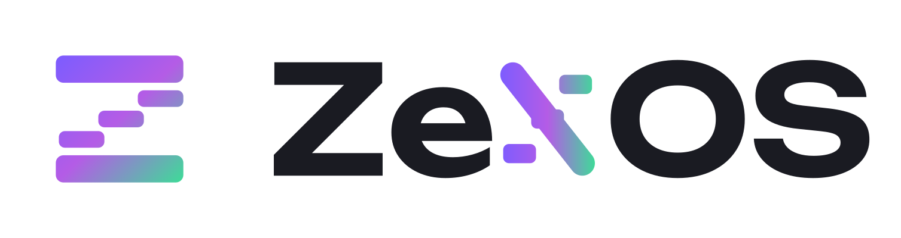
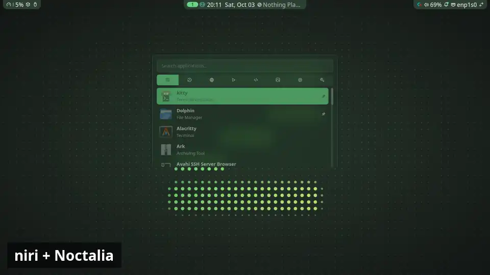

<p align="center">
  <picture>
    <source media="(prefers-color-scheme: dark)" srcset="docs/logo/zexos-logo-dark.svg">
    
  </picture>
</p>

<h3 align="center">A ready-to-use, themed desktop for Arch Linux and CachyOS.<br>One command, or one ISO, and you have a complete daily desktop.</h3>

<p align="center">
  <a href="https://github.com/zefuros1991/ZeXOS/releases/latest"></a>
  <a href="LICENSE"></a>
  
  
  
</p>

<p align="center">
  <a href="https://zefuros1991.github.io/ZeXOS/?from=readme#1">Gallery</a> ·
  <a href="docs/install.md">Install</a> ·
  <a href="docs/README.md">Docs</a> ·
  <a href="CHANGELOG.md">Changelog</a> ·
  <a href="ROADMAP.md">Roadmap</a>
</p>

<p align="center"><a href="https://zefuros1991.github.io/ZeXOS/?from=readme#1"></a></p>

## What you get

- **Three compositors, two shells**: [niri](https://github.com/YaLTeR/niri), Hyprland and Mango, with Noctalia or DankMaterialShell. Pick the compositor at the login screen, switch shells with `Mod+Shift+D`.
- **Colours from your wallpaper**: GTK, Qt and KDE apps, the terminal and the launcher all follow it. A mostly white wallpaper switches to light mode on its own.
- **A wallpaper picker** on `Mod+W`, including animated wallpapers.
- **A login screen and terminal to match**: SDDM with the Pixie theme, and kitty with system info and a two-line prompt in your wallpaper's colours.
- **Everyday apps ready**: kitty, Dolphin, Gwenview, Neovim and VLC. Your browser and your shell stay yours.
- **Keys that are the same everywhere**: one set of keybinds on all three compositors.

Everything in detail: [Customizing ZeXOS](docs/customizing.md).

## Get ZeXOS

**On a new PC:** download the installer ISO. It has a graphical and a text installer.

<p align="center"><a href="https://github.com/zefuros1991/ZeXOS/releases/latest"></a></p>

**On an Arch-based system you already have** (CachyOS, Arch Linux, EndeavourOS), run this as your normal user:

```bash
curl -fsSL https://raw.githubusercontent.com/zefuros1991/ZeXOS/main/install.sh -o /tmp/zexos-install.sh; bash /tmp/zexos-install.sh; rm -f /tmp/zexos-install.sh
```

It works the same in fish, bash and zsh. The old desktop stays in the login screen's session list. More options, such as picking only some compositors or shells: [Installing ZeXOS](docs/install.md).

## Documentation

| | |
|---|---|
| [Installing ZeXOS](docs/install.md) | Distros, packages, the ISO, what the installer does |
| [Main keybinds](docs/keybinds.md) | The keys you use every day |
| [Compositors and shells](docs/compositors-and-shells.md) | niri, Hyprland, Mango, Noctalia, DankMaterialShell |
| [Wallpapers and screens](docs/wallpapers-and-screens.md) | Wallpapers, animated wallpapers, screen setup |
| [Customizing ZeXOS](docs/customizing.md) | Everything ZeXOS sets up and the config packages |

Questions, bugs and ideas: see [CONTRIBUTING](CONTRIBUTING.md). Security problems: [SECURITY](SECURITY.md).

## License

[MIT](LICENSE). Thanks to everyone whose work ZeXOS builds on: see [CREDITS](CREDITS.md).
