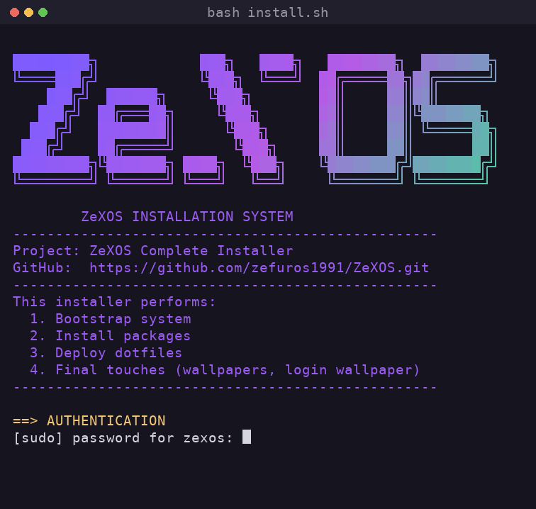

# Installing ZeXOS

Two ways in: run the install script on an Arch-based system you already have, or use the installer ISO on an empty PC. The script takes about 2½ minutes on a fresh Arch.

## Before you start

**Tested and working**

- CachyOS
- Arch Linux
- EndeavourOS

Other Arch-based distros that use Arch's own repos are likely to work too, but haven't been tried yet. The desktop you picked during that distro's install (KDE, GNOME, niri or none) doesn't matter. ZeXOS adds what's missing, and your old desktop stays in the login screen's session list.

**Not supported**

- **Manjaro**: it has its own, delayed repos.
- **Artix**: it doesn't use systemd.

On those two the installer stops early and says why.

**You need**

- [ ] A normal user account that can use `sudo`. Don't run it as root.
- [ ] A network connection.

`git` is added for you if it's missing. Everything else, including `stow`, comes with the install.

## Install with the script

1. Open a terminal as your normal user.
2. Paste this and press Enter:

   ```bash
   curl -fsSL https://raw.githubusercontent.com/zefuros1991/ZeXOS/main/install.sh -o /tmp/zexos-install.sh; bash /tmp/zexos-install.sh; rm -f /tmp/zexos-install.sh
   ```

   It downloads the installer, runs it, then deletes it. It works the same in fish, bash and zsh.

3. Type your `sudo` password when asked. The gradient ZeXOS logo animates while the installer waits for it.

   <p align="center"></p>

4. Choose **1. Ready-made** when asked how to get ZeXOS's own packages. It is the default and the fast one. [Not sure? Compare the two.](install-options.md#ready-made-or-build-it-yourself)
5. Wait for it to finish. At the end you get a short result for each part, ✔ or ✖.
6. Log out. On the login screen, pick **niri**, **Hyprland** or **Mango** from the session menu next to the password box.

> **Don't use `curl … | bash`.** The installer asks for your `sudo` password, and piping the script in takes over the input that prompt needs.

**Already cloned the repo to `~/.dotfiles`?**

```bash
cd ~/.dotfiles
./install.sh
```

## Install from the ISO

Use this on an empty PC. It installs Arch and ZeXOS together.

1. Download the installer ISO from the [Releases page](https://github.com/zefuros1991/ZeXOS/releases/latest).
2. Boot the PC from it. You get a graphical and a text installer.
3. Follow the installer.

A system installed this way is called **ZeXOS** in `/etc/os-release`. Under the hood it is plain Arch and says so (`ID_LIKE=arch`), so Arch packages and guides apply. Installing with the script on a system you already have keeps that system's name and logo.

How the ISO is built: [iso/README.md](../iso/README.md).

## Something went wrong?

Every step keeps a log in `~/.dotfiles`. Look there first. See [Troubleshooting](troubleshooting.md) for fixes by symptom.

## Next

- [Install options](install-options.md): install only some compositors or shells, or build the packages yourself
- [Main keybinds](keybinds.md): the keys you use every day
- [How the installer works](how-the-installer-works.md): what each script does

---

[Back to the README](../README.md) · [All docs](README.md)
