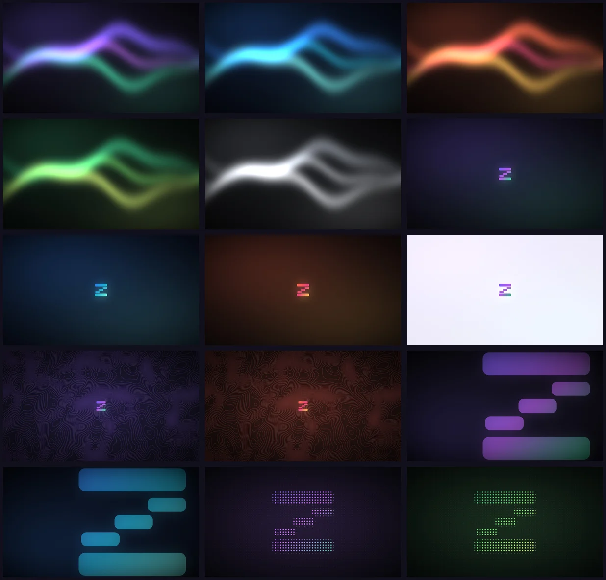

# Wallpapers and screens

Change your wallpaper, play an animated one, or set up your screens.

## Wallpapers

ZeXOS comes with 16 wallpapers of its own, in 5 styles and several colours each, plus 9 animated ones. The installer copies them to `~/Pictures/Wallpapers`. You start on `zexos-aurora`, and the login screen starts with it too.

<a href="https://zefuros1991.github.io/ZeXOS/?from=readme#16"></a>

### Pick another wallpaper

1. Press `Mod+W` to open roller.
2. Choose a picture.

The colour theme follows whichever one is active. For a surprise, `Mod+Ctrl+W` picks one at random.

### Use your own pictures

Put them in `~/Pictures/Wallpapers`. Noctalia and roller read from there.

### Make them in another size

All the wallpapers are drawn by a small script, with no photos or downloads. Run this from `~/.dotfiles` (the numbers are width and height):

```bash
python wallpapers/make-wallpapers.py 2560 1440
```

## Animated wallpapers

Nine of the wallpapers also come as 12-second looping videos, covering every style and colour family. They live in `~/Pictures/Wallpapers/Animated`. None is switched on by default, because a looping 4K video puts a small, constant load on the machine.

| Video | What moves |
|---|---|
| `zexos-aurora`, `-ocean`, `-mono` | The three light ribbons ripple, sway and drift |
| `zexos-topo-energy`, `zexos-topo-ember` | Energy runs along the contour lines |
| `zexos-mark-ember`, `-light` | The logo's glow breathes and a sheen passes over it. The logo stays still. |
| `zexos-bars` | The bars rise and fall gently, like a slow equaliser |
| `zexos-dots-forest` | A wave of light passes through the dots, and some twinkle |

### Play one

1. Press `Mod+Shift+W` to open roller on the videos.
2. Pick one. Video cards carry a ▶ badge.

It plays with Noctalia's Video Wallpaper plugin, and its first frame becomes the picture the colour theme follows. Picking a picture stops the video.

Under DankMaterialShell, which can't play videos, you get the first frame as a still.

`Mod+W` opens roller on the pictures, and `Tab` switches between the two groups.

### Make the videos

The animated ones are drawn by the `wallpapers/make-*-video.py` scripts in `~/.dotfiles`. They need `python-numpy`, `python-pillow` and `ffmpeg`.

## Screens

niri detects your screens by itself. To set resolution, scale or position yourself, find your screens' names first, then add a block for each one to the compositor's monitors file.

| Compositor | 1. List your screens | 2. Add to this file |
|---|---|---|
| niri | `niri msg outputs` | `stow/niri/.config/niri/monitors.kdl` (there's a commented example in the file) |
| Mango | `mmsg get all-monitors` | `stow/mango/.config/mango/monitors.conf`, as `monitor_rule=` lines |
| Hyprland | `hyprctl monitors` | `stow/hyprland/.config/hypr/monitors.lua`, as `hl.monitor` lines |

---

[Back to the README](../README.md) · [All docs](README.md)
